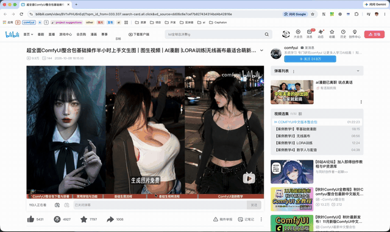

# ScreenPin

把屏幕上框选的任意一块区域，变成一颗永远置顶的实时小窗。

录口播时把提词稿钉在摄像头旁边、剪辑时把参考片钉在角落、看数据时把后台常驻在小窗里——
不用截图、不用切换窗口，那块画面是活的，源内容滚动画面上就跟着滚动。

纯 Swift + AppKit 单文件，无第三方依赖，菜单栏常驻，不占 Dock。

用法演示（框选 → 就地钉住 → 日常操作）：



## 下载

去 [Releases](https://github.com/981859608/screen-pin/releases) 拿 `ScreenPin-1.0.dmg`：双击挂载，把 ScreenPin 拖进「应用程序」。

第一次打开会被 Gatekeeper 拦（它用的是作者本机的自签证书，不是 Apple 开发者证书）：先试 **右键点图标 → 打开**；如果提示"已损坏"，执行：

```sh
xattr -dr com.apple.quarantine /Applications/ScreenPin.app
```

然后去 系统设置 → 隐私与安全性 → 屏幕与系统音频录制 勾上 ScreenPin，退出重开一次。要求 macOS 14 及以上。

不想下载的话，从源码构建也就两条命令，见下面的「构建并运行」。

## 能做什么

| 操作 | 效果 |
| --- | --- |
| 菜单栏图钉图标 → `框选新区域` | 全屏进入取框模式，拖出矩形即钉住 |
| `fn` + `F2` | 全局快捷键，等同于点 `框选新区域`，无需任何辅助权限 |
| 拖框时 | 实时显示 `宽 × 高`，松手即钉；小窗**出现在框选的原位置**，不会跳到角落 |
| 鼠标按住小窗任意位置 | 立刻拖走，不需要先"选中/聚焦" |
| 鼠标滚轮 / 触摸板双指捏合 | 以指针为锚点放大缩小，放大上限 4 倍，最小可到 24 × 16 |
| `Esc` | 焦点在某颗小窗上时关闭该小窗 |
| `⌘W` | 同上 |
| 双击小窗画面 | 跳回源 App：把它调到前台，同时默认关掉这颗小窗（可在设置里改成保留） |
| 取框模式下直接单击（不拖框） | 取消本次框选 |
| 菜单栏 → `关闭全部小窗` | 一次清掉所有小窗 |

聚焦中的小窗会描一圈系统蓝色边框，所以按 `Esc` 关掉的究竟是哪一颗，看得见。

## 设置

菜单栏图钉图标 → `设置…`（`⌘,`）。三项都有默认值，改完立刻生效，不需要重启。

| 分组 | 设置项 | 默认 | 说明 |
| --- | --- | --- | --- |
| 交互 | 双击跳回主应用后自动关闭小窗 | 开 | 关掉后小窗会留在屏幕上（它盖住的正是你刚跳回去的那块内容） |
| 质量配置 | 像素与原屏幕一致（高清） | 开 | Retina 屏上按 2 倍像素采集。关掉后帧只有逻辑尺寸，省 CPU 但画面会糊 |
| 质量配置 | 帧率 | 60 | 可选 15 / 24 / 30 / 60 / 120 |

改"质量配置"里任何一项，已经在跑的小窗会立刻按新配置重建画面管线——**小窗的位置、尺寸和当前缩放都保持不变**，只是中间会闪一下。

设置存在系统的偏好数据库里（`defaults` 域 `com.wangsen.screenpin`），退出重开、重新构建都不会丢。

## 环境要求

- macOS 14.0 及以上（用到 ScreenCaptureKit）
- Xcode 或 Command Line Tools 自带的 `swiftc`
- **屏幕录制**授权（`系统设置 → 隐私与安全性 → 屏幕与系统音频录制`）

## 构建并运行

```sh
sh make-cert.sh      # 只需一次：生成本机自签证书 ScreenPin Local
sh build.sh --run    # 编译并打开
```

`make-cert.sh` 生成一张有效期 10 年的自签代码签名证书并导入登录钥匙串。这一步不是可选的：
macOS 的录屏授权按"签名身份"记账，没有固定身份时每次重新构建都要重新授权一次。
私钥只进钥匙串，仓库里不留任何密钥文件。

`build.sh` 的其他用法：

```sh
sh build.sh                # 只构建，产物在 build/ScreenPin.app
sh build.sh --regrant      # 构建后清掉旧的录屏授权，用于重新勾选
```

## 权限掉落的排查

画面变成桌面壁纸、或者整块黑屏但没有报错，基本都是授权对不上：

1. 确认 `系统设置 → 屏幕与系统音频录制` 里 `ScreenPin` 是勾上的；
2. 勾选后必须**退出重开**（菜单栏 → `退出 ScreenPin`），授权不会热生效；
3. 仍然异常，先 `sh build.sh --regrant` 清掉旧记录再重开；
4. 不要改 `src/Info.plist` 里的 `CFBundleIdentifier`（`com.wangsen.screenpin`）和产物路径，
   授权是按 bundle 身份记录的，改了等于从头再来。

## 已知限制

- **最多同时钉 3 颗**小窗，再多会提示。
- **放大会糊**：放大只是把已经采到的像素摊开，不会补充细节，所以上限锁在 4 倍。
- **受保护内容会全黑**：部分正版视频 App 有 DRM 图层，捕获到的是黑屏，小窗会直接标出"画面全黑：可能是受保护的视频"。
- **源画面静止时不会有新帧**，这是 ScreenCaptureKit 的正常行为，不是卡住。
- **只能钉普通层级的窗口内容**：桌面图标、菜单、提示框这类不在普通窗层的区域钉不住，会提示"这里没有可钉住的窗口"。
- 源窗口被关闭时小窗显示"源窗口已关闭"，不会自动回收，需要手动关掉。
- 双击跳回源 App 默认会关掉那颗小窗；在设置里改成保留后，它会继续浮在你跳回去的画面上（置顶是它的基本设定），需要自己拖开或按 `Esc`。
- 双击只能把 App 带到前台。**源窗口被最小化到 Dock 时不会自动展开**：展开具体某颗窗口需要"辅助功能"授权，为了这个动作用户体验反而变差，所以没做。
- **帧率是采集上限，不是保证值**：屏幕本身 60Hz 时选 120 也拿不到更多帧；同时钉 3 颗小窗再跑 60fps，老机器上会掉帧。
- `fn + F2` 依赖系统键盘行为：若你在"键盘"设置里勾了"将 F1、F2 等键用作标准功能键"，单按 `F2` 也会触发。
- 取框遮罩期间只有"单击"能取消，按 `Esc` 目前还不会退出取框模式。
- Release 里的 dmg 用作者本机的自签证书签名，没有 Apple 开发者证书、也没做公证，所以别人首次打开一定会被 Gatekeeper 拦一次（解法见「下载」一节）。

## 代码结构

整个应用是一个文件：`src/main.swift`（约 1000 行）。分成这些部分：

- `Config` —— 数量上限、缩放上下限、帧率档位等固定参数集中在这里
- `Prefs` —— 用户可改的偏好（双击后是否关窗、高清像素、帧率），落在 `UserDefaults` 上
- `Geo` —— Cocoa（原点左下、y 向上）与 CGWindowList/ScreenCaptureKit（原点左上、y 向下）两套坐标系互转
- `HitTest` / `Target` —— 把框选矩形换算成"某个源窗口 + 相对它左上角的裁剪区"
- `Capture` —— 一路 ScreenCaptureKit 流，按裁剪区出帧
- `PinScale` —— 缩放倍率的上下限与锚点计算，小窗尺寸恒等于「钉住时的尺寸 × 倍率」
- `PinPanel` / `PinRootView` —— 置顶面板与画面视图，负责拖拽、滚轮、捏合、`Esc`
- `Pin` —— 一颗小窗的生命周期：捕获、渲染、断流看门狗
- `SelectionWindow` / `SelectionView` —— 全屏取框遮罩
- `SettingsWindow` —— 设置表单，代码搭的，不引 xib 也不引 SwiftUI
- `HotKey` —— Carbon 全局热键，不需要辅助功能授权
- `AppController` —— 菜单栏、小窗列表、设置入口、多显示器变化时重新对齐
- `Probe` —— 构建期自测代码，用来确定 `sourceRect` 的单位与方向

坐标系是这个项目最容易踩坑的地方：`CGWindowList` 和 `SCWindow.frame` 是左上角原点、y 向下，
Cocoa 窗口和选区是左下角原点、y 向上，注释里标了哪一步能翻、哪一步不能再翻。

### 开发用参数

正常运行时不带这些参数，直接 `open` 即可：

```sh
build/ScreenPin.app/Contents/MacOS/ScreenPin --autopin=x,y,w,h   # 跳过取框，按 Cocoa 全局坐标（单位点）直接钉住一块
build/ScreenPin.app/Contents/MacOS/ScreenPin --settings           # 启动时直接把设置窗打开，方便截图核对排版
build/ScreenPin.app/Contents/MacOS/ScreenPin --snaptest          # 跑 Probe，验证裁剪区的单位与方向
```

`--autopin` 用来在没有鼠标操作的情况下复现问题：把某块区域钉上后就能反复测试缩放、断流、黑边这类只在运行期暴露的行为。

## 许可

Apache License 2.0，见 [LICENSE](LICENSE)。
